<picture>
  <source media="(prefers-color-scheme: dark)" srcset=".github/assets/gate-dark.svg">
  
</picture>

# Anderson F. González

*Production is the real test environment.*

Full-stack developer focused on backend, integrations and security. I study Systems Engineering at the University of Pamplona, Colombia, and I am open to internships and employment from January 2027.

Desarrollo software con énfasis en backend, integraciones y seguridad, y escribo en español sin problema: [portafolio en español](https://anderdev.works/es).

[Portfolio](https://anderdev.works/en) · [Résumé](https://anderdev.works/cv/Anderson_Gonzalez_CV_EN.pdf) · [LinkedIn](https://www.linkedin.com/in/anderson-gonzaleza21/) · [Email](mailto:fabianagcris@gmail.com)

## Selected work

- **Talento Rosimar** (client work): a résumé reader that runs in the browser, measured against fixed benchmarks. [Case study](https://anderdev.works/en/work/talento-rosimar)
- **CircuitBreve** (open source): a logic circuit simulator in the browser. [Demo](https://circuit-breve.vercel.app) · [Code](https://github.com/Albonire/CircuitBreve)
- **NotebookLM Watermark Remover** (open source): a command-line tool that cleans PDF, PPTX and image files. [Code](https://github.com/Albonire/notebooklm-watermark-remover)

More in the [portfolio](https://anderdev.works/en#work).

## Stack

TypeScript, JavaScript, Python, PHP, SQL · Node.js, Laravel, Django, FastAPI, React, Next.js · PostgreSQL, MySQL, Redis · AWS, Oracle Cloud, Docker, Linux

七転び八起き · *nana korobi ya oki*: fall seven times, get up eight.
